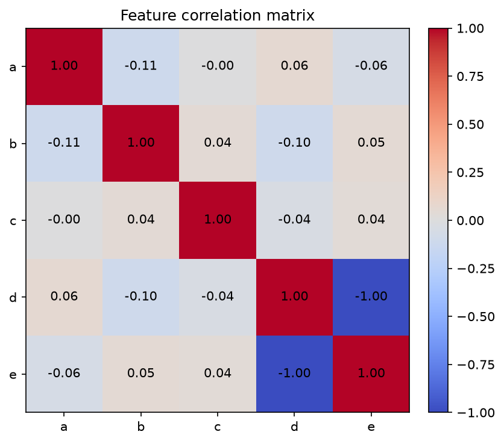
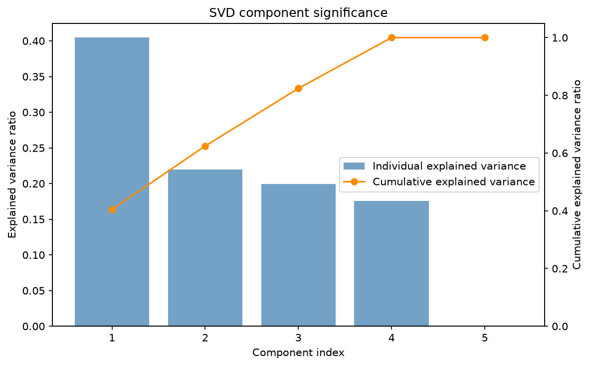
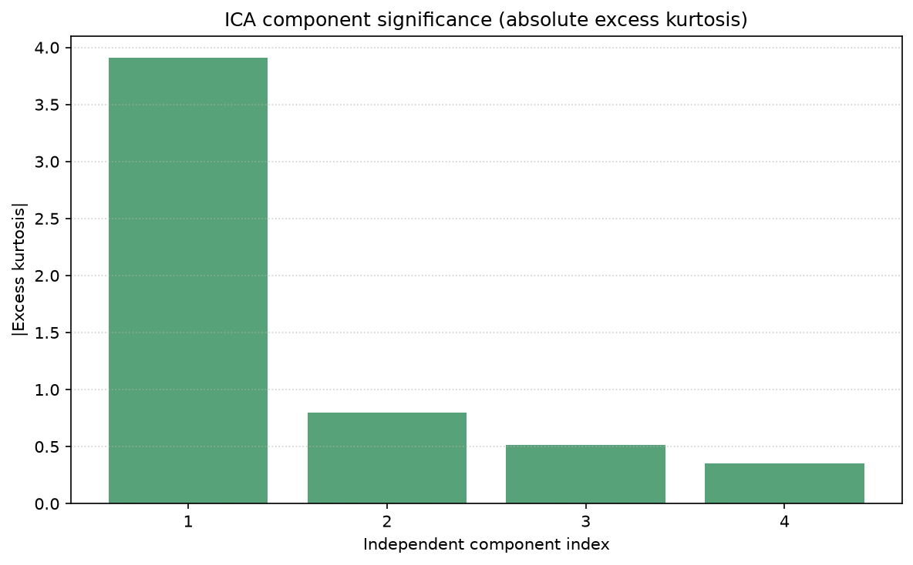
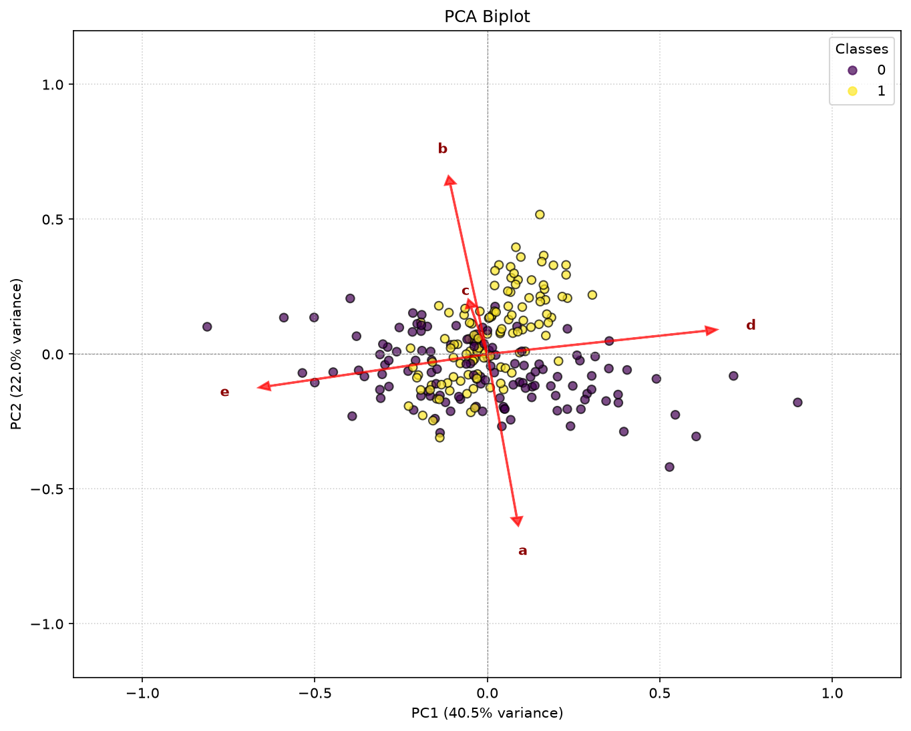
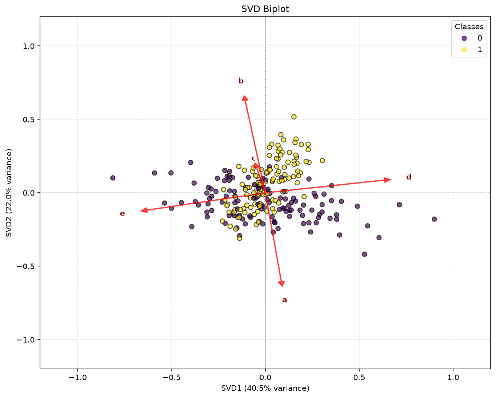
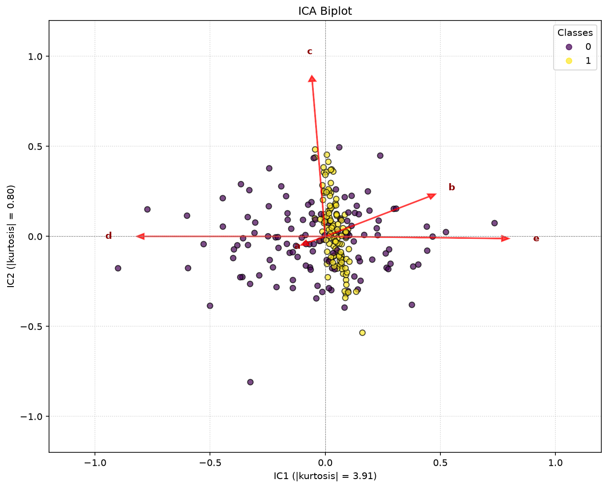
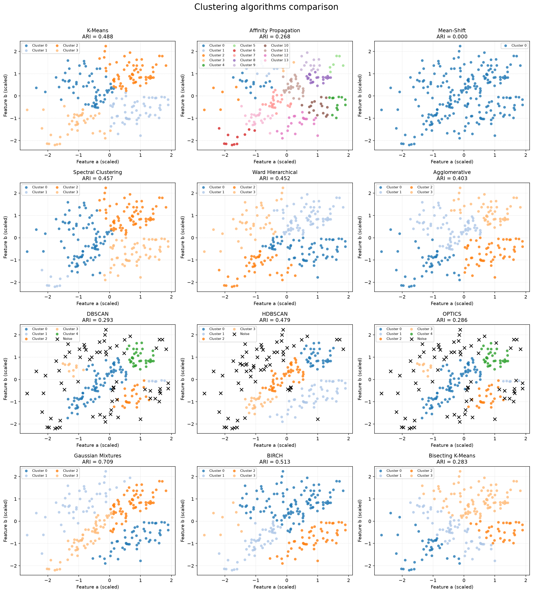
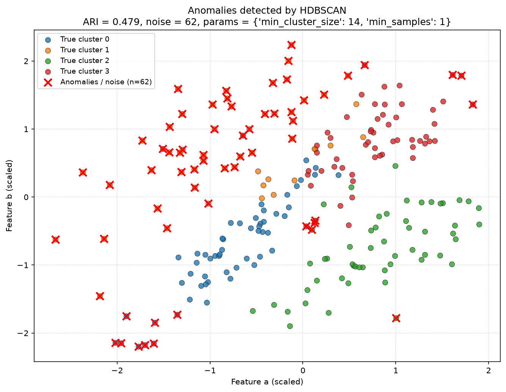

# Лабораторная работа №2. Обучение без учителя (Вариант 1)

**Тема:** «Понижение размерности. Обнаружение аномалий. Кластеризация»

Репозиторий содержит полный цикл исследования: загрузку варианта 1, стандартизацию признаков, корреляционный анализ, понижение размерности методами PCA, TruncatedSVD и FastICA, кластеризацию 12 алгоритмами `scikit-learn`, автоматический подбор параметров плотностных методов и обнаружение аномалий.

## Структура проекта

| Путь | Назначение |
|---|---|
| `lab2_part1.py` | Часть 1: корреляционный анализ, scatter matrix, PCA, SVD, ICA, графики значимости компонент и biplot-диаграммы. |
| `lab2_part2.py` | Часть 2: кластеризация 12 алгоритмами, Grid Search для DBSCAN/HDBSCAN/OPTICS, сравнение ARI, поиск аномалий. |
| `lab2_part1_plots/` | Графики Части 1: тепловая карта корреляций, scatter matrix, значимость компонент и biplot для PCA/SVD/ICA. |
| `clustering_comparison_4x3.png` | Сводная сетка результатов всех 12 алгоритмов кластеризации с ARI в заголовках. |
| `detected_anomalies.png` | Истинные классы и аномалии, обнаруженные лучшим плотностным методом (HDBSCAN). |
| `.gitignore` | Исключение исходных `.xlsx`/`.pdf`, кэша Python и служебных файлов. |
| `README.md` | Описание проекта, результаты и выводы. |

## Часть 1. Понижение размерности и отбор признаков

### Данные и корреляционный анализ

Датасет `Lab2_Dataset_PCA.xlsx`, вариант 1: **243 объекта**, признаки `a`, `b`, `c`, `d`, `e`. Метка `y` (класс 0 — 124 объекта, класс 1 — 119 объектов) использовалась только для визуализации и проверки, но не при обучении моделей.

Матрица корреляций признаков:

| | a | b | c | d | e |
|---|---:|---:|---:|---:|---:|
| **a** | 1.0000 | −0.1141 | −0.0012 | 0.0622 | −0.0568 |
| **b** | −0.1141 | 1.0000 | 0.0417 | −0.1020 | 0.0525 |
| **c** | −0.0012 | 0.0417 | 1.0000 | −0.0398 | 0.0378 |
| **d** | 0.0622 | −0.1020 | −0.0398 | 1.0000 | **−0.9988** |
| **e** | −0.0568 | 0.0525 | 0.0378 | **−0.9988** | 1.0000 |

Ключевой вывод: между признаками **`d` и `e` обнаружена практически функциональная обратная линейная зависимость (`r = −0.9988`)**. Остальные пары признаков слабо коррелированы (`|r| ≤ 0.1141`), а признаки `a` и `c` по коэффициенту эксцесса близки к гауссовскому шуму (`|excess kurtosis| = 0.4716` и `0.5392` соответственно).



### Ранг матрицы, PCA и SVD

Ранг матрицы признаков равен **4**, то есть один из пяти признаков линейно избыточен. Нулевое сингулярное значение соответствует линейной комбинации, определяемой главным образом признаками `d` и `e`.

| Компонента | PCA, explained variance ratio | SVD, explained variance ratio | Накопленная дисперсия PCA |
|---|---:|---:|---:|
| PC1 | 0.4046 | 0.4046 | 0.4046 |
| PC2 | 0.2198 | 0.2198 | 0.6244 |
| PC3 | 0.1997 | 0.1997 | 0.8241 |
| PC4 | 0.1759 | 0.1759 | 1.0000 |
| PC5 | 0.0000 | 0.0000 | 1.0000 |

PCA и SVD дали идентичные значения объяснённой дисперсии. Первые три компоненты объясняют **82.41%** дисперсии и отнесены к главным, PC4 — к второстепенным, PC5 с нулевой дисперсией — к шумовым/избыточным.




### ICA и оценка по эксцессу

Из-за ранга матрицы, равного 4, для FastICA использованы **4 независимые компоненты**. Значимость оценивалась по абсолютному избыточному эксцессу `|excess kurtosis|`:

| Компонента | \|excess kurtosis\| | Интерпретация |
|---|---:|---|
| IC1 | **3.9067** | Главный негауссов сигнал; определяется вкладами `d`, `e` и `b`. |
| IC2 | 0.8014 | Преимущественно `c`; близка к гауссовскому шуму. |
| IC3 | 0.5154 | Преимущественно `a`; близка к гауссовскому шуму. |
| IC4 | 0.3505 | Шумовая компонента. |

Таким образом, ICA по эксцессу выделила **IC1 как единственный ярко выраженный информативный сигнал** (`|excess kurtosis| = 3.9067`), тогда как компоненты, связанные с `a` и `c`, имеют низкий эксцесс (`0.5154` и `0.8014`) и ведут себя как близкий к гауссовскому шум.



### Biplot-проекции

| PCA Biplot | SVD Biplot | ICA Biplot |
|---|---|---|
|  |  |  |

Дополнительно в каталоге `lab2_part1_plots/` сохранены `02_scatter_matrix.png` (матрица разброса признаков) и графики значимости компонент для каждого метода.

## Часть 2. Кластеризация и поиск аномалий

### Данные и методика

Датасет `Lab2_Dataset_Clustering.xlsx`, вариант 1: **222 объекта**, признаки `a` и `b`. Классы `y`: 0 — 56, 1 — 54, 2 — 55, 3 — 57 объектов. Перед кластеризацией признаки стандартизированы `StandardScaler`.

Для **DBSCAN, HDBSCAN и OPTICS** выполнен автоматический Grid Search с оптимизацией по `adjusted_rand_score` относительно истинных меток `y`. Для остальных алгоритмов использованы фиксированные параметры (число кластеров — 4).

### Бенчмарк 12 алгоритмов

| Алгоритм | ARI | Параметры и результат |
|---|---:|---|
| **Gaussian Mixtures** | **0.7091** | `n_components=4`; лучший результат среди всех методов. |
| BIRCH | 0.5131 | `n_clusters=4`. |
| K-Means | 0.4882 | `n_clusters=4`. |
| **HDBSCAN** | **0.4795** | `min_cluster_size=14`, `min_samples=1`; 4 кластера, **62 аномалии**. |
| Spectral Clustering | 0.4573 | `n_clusters=4`. |
| Ward Hierarchical | 0.4523 | `n_clusters=4`, `linkage=ward`. |
| Agglomerative | 0.4026 | `n_clusters=4`, `linkage=complete`. |
| DBSCAN | 0.2934 | `eps=0.3`, `min_samples=6`; 5 кластеров, 68 аномалий. |
| OPTICS | 0.2863 | `cluster_method=dbscan`, `min_samples=6`, `max_eps=0.3`; 5 кластеров, 71 аномалия. |
| Bisecting K-Means | 0.2832 | `n_clusters=4`. |
| Affinity Propagation | 0.2684 | `damping=0.9`, 14 кластеров. |
| Mean-Shift | 0.0000 | Автоматическая оценка bandwidth привела к одному кластеру. |



### Лучший плотностной метод: HDBSCAN

HDBSCAN показал лучший результат среди плотностных алгоритмов: **ARI = 0.4795** при `min_cluster_size=14` и `min_samples=1`. Метод выделил **4 кластера** и **62 аномальные (шумовые) точки**, то есть около **27.9%** наблюдений. Это лучший баланс между качеством разделения и выделением выбросов по сравнению с DBSCAN (ARI = 0.2934, 68 аномалий) и OPTICS (ARI = 0.2863, 71 аномалия).



## Основные выводы

1. В признаках `d` и `e` присутствует сильная мультиколлинеарность (`r = −0.9988`), а ранг матрицы равен 4; пятая главная компонента имеет нулевую объяснённую дисперсию.
2. PCA и SVD дают одинаковое разложение: первые три компоненты объясняют 82.41% дисперсии, PC4 второстепенна, PC5 является избыточной/шумовой.
3. ICA по эксцессу выделяет IC1 (`|excess kurtosis| = 3.9067`) как основной негауссов сигнал; компоненты, связанные с `a` и `c`, близки к гауссовскому шуму.
4. Лучшим алгоритмом кластеризации для данного датасета является **Gaussian Mixtures (ARI = 0.7091)**, а лучшим плотностным методом — **HDBSCAN (ARI = 0.4795)** с 62 обнаруженными аномалиями.

## Запуск

```bash
python lab2_part1.py
python lab2_part2.py
```

Требуемые библиотеки: `pandas`, `numpy`, `scipy`, `scikit-learn`, `matplotlib`, `openpyxl`.

Все стохастические методы зафиксированы через `random_state`, поэтому результаты воспроизводимы.
